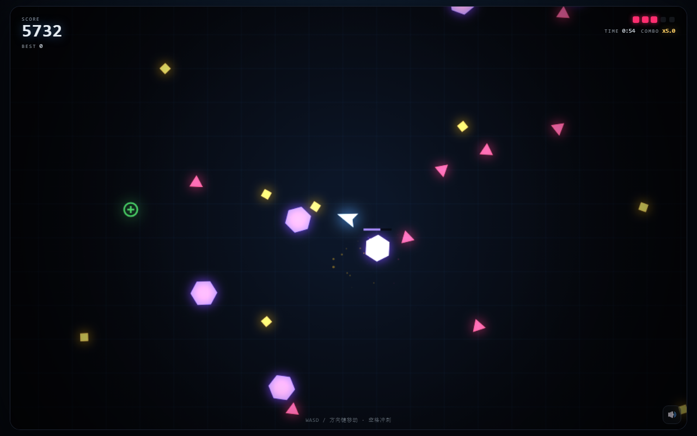

# NEON SIEGE · 霓虹围城

> 一个单文件街机生存射击游戏。自动瞄准，你只负责走位和冲刺。

**▶ 在线试玩：<https://123a-lhw.github.io/neon-siege/>**



## 玩法

| 操作 | 键位 / 手势 |
| --- | --- |
| 移动 | `W` `A` `S` `D` / 方向键 / 手机拖拽（按下点为摇杆原点） |
| 冲刺（短暂无敌） | `空格` / 右下角「冲刺」按钮（带冷却环） |
| 暂停 | `P` / 右上角暂停按钮 / 切后台自动暂停 |
| 静音 | `M` / 右下角喇叭 |
| 重开 | 结算页点击、`空格`、`回车`、`R` |

- 炮塔**自动锁定视野内最近的敌人**，不用瞄准。
- 击杀累积 **COMBO**，最高 **x5.0** 分数倍率（第 1 杀 x1.0，第 41 杀起封顶）；2.5 秒不击杀则中断。
- 三种敌人：粉色三角（基础）、黄色菱形（高速、走位飘忽）、紫色六边形（5 血重甲，带血条）。
- 血量 3 起、上限 5，绿色「+」补给可回血；每 16 秒尝试刷新一次，场上最多 2 个。
- 分数越高、时间越久，刷怪越密、越快——站着不动大约 55 秒就会被压死。

## V1.0 修订版新增（P0）

- **移动端完整可玩**：独立冲刺按钮（热区 64×64，视觉 56px，冷却环形进度）与暂停按钮（热区 48×48，视觉 40×40）；按钮边缘 12px 内起手不会误触发移动。
- **减少动效**：菜单/暂停页可切换；关闭屏幕震动与全屏闪红，受击改用边缘脉冲提示，偏好写入本地。
- **隐私说明页**：菜单与结算页可进入，列明 `localStorage` 键、数据用途与「不接入第三方 SDK / 不采集身份与位置」，并提供「清除本机数据」。
- **首次访问年龄提示**：16 岁以下需监护人同意；可选择「同意并继续」或「仅本地游玩」。
- **匿名埋点**：同意后记录 `app_open / run_start / kill / hurt / combo_break / game_over / restart`，仅写本地环形缓冲（≤200 条）、不联网；拒绝则只保留最高分。
- **最高分即时写入**：每次刷新纪录立刻落盘，刷新/关闭/崩溃不丢分。
- **分享准备度**：OG / Twitter 标签、结算页可直接截图的成绩链接（`?score=N` 可回填挑战目标）。

## 技术

- **单文件、零依赖**：`index.html` 一个文件包含全部 HTML / CSS / JS，无构建、无框架、无第三方库（49.5 KB，gzip 15.6 KB）。
- **Canvas 2D** 渲染，`requestAnimationFrame` + 固定步长（1/120s）累加器，掉帧不影响物理表现。
- **WebAudio** 程序化合成 7 类音效，不加载任何音频资源；总线带限幅器，高密度射击不削波。
- 高 DPI 适配（`devicePixelRatio` 上限 2），响应式布局，320px 宽度 HUD 不重叠，刘海屏安全区适配。
- 全部状态集中在单个闭包内，仅暴露 `window.__NEON` 调试接口供自动化测试使用。

## 本地运行

直接双击 `index.html` 即可，不需要服务器。

想用服务器：

```bash
python -m http.server 8000
# 打开 http://localhost:8000
```

调试参数：

| 参数 | 作用 |
| --- | --- |
| `?auto=1` | 跳过菜单与首次提示，直接开局（截图 / 自动化） |
| `?sim=12` | 配合 `auto`，同步推进 12 秒后渲染一帧（手势复现） |
| `?score=120` | 菜单显示「目标分数 120 · 挑战它」 |

## 测试

```bash
node test/run.mjs   # 规则层：34 项，Node + 最小 DOM/Canvas 桩
node test/e2e.mjs   # 浏览器层：22 项，Edge/Chrome headless + CDP，零依赖
```

E2E 需要在本机找到 Edge/Chrome（可用 `NEON_BROWSER` 指定路径）。浏览器进程无法在受限沙箱内创建 IPC 管道，如果测试运行器有沙箱限制，需要在完整权限下执行。

详见 [test/README.md](./test/README.md)。

## 许可证

[MIT](./LICENSE)
